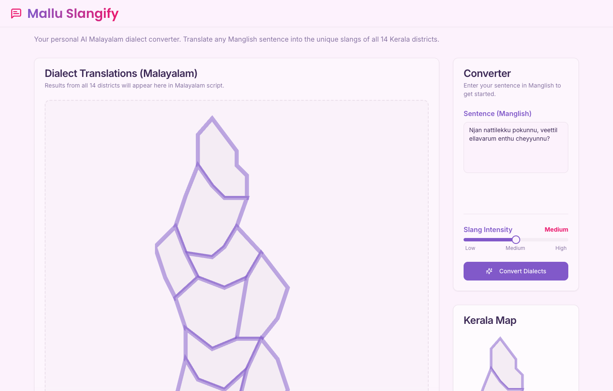
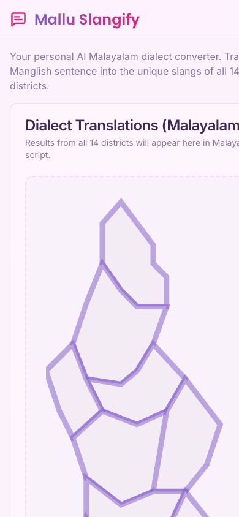

# Mallu Slangify 🎯

[](https://malluslangify.vercel.app)
[](https://nextjs.org/)
[](https://www.typescriptlang.org/)
[](https://ai.google.dev/)
[](https://tinkerhub.org)

An AI-powered regional dialect translation engine that converts Malayalam / Manglish input sentences into authentic native slangs across all 14 districts of Kerala with dynamic intensity controls and cultural linguistic insights.

🔗 **Live Application:** [malluslangify.vercel.app](https://malluslangify.vercel.app)

---

## 📸 Application Interface

### Desktop View
<p align="center">
  
</p>

### Mobile View
<p align="center">
  
</p>

---

## 🚀 Overview

Regional Malayalam varies significantly across Kerala—from the distinct cadence and idioms of Kannur, Kozhikode, and Malappuram, to the colloquial phrases of Thrissur, Kochi, and Trivandrum. 

**Mallu Slangify** translates input sentences while preserving context and meaning, applying authentic dialect vocabulary, phonetic shifts, and local idioms tailored to specific districts.

### Key Capabilities
- **14-District Regional Coverage:** Real-time dialect transformations tailored for Kannur, Kozhikode, Malappuram, Thrissur, Ernakulam, Trivandrum, and all other Kerala districts.
- **Slang Intensity Tuning:** Selectable intensity parameters ranging from mild colloquialisms to heavy native slang.
- **Cultural Context Cards:** Contextual linguistic breakdown explaining district-specific vocabulary, etymology, and popular idioms.
- **Serverless Edge Performance:** Built with Next.js App Router and Server Actions for low-latency streaming inference.

---

## 🛠️ Architecture & Tech Stack

```text
┌─────────────────┐       Server Actions       ┌───────────────────────────┐
│   React / UI    │ ─────────────────────────> │   Next.js App Server      │
│ (Tailwind/Radix)│ <───────────────────────── │                           │
└─────────────────┘      Structured JSON       └─────────────┬─────────────┘
                                                             │
                                                      Genkit SDK / API
                                                             │
                                                             ▼
                                               ┌───────────────────────────┐
                                               │   Google Gemini Engine    │
                                               │ (Dialect & NLP Workflows) │
                                               └───────────────────────────┘
```

- **Frontend:** Next.js (App Router), React, Tailwind CSS, ShadCN UI, Lucide Icons.
- **AI / NLP Backend:** Google Gemini API integrated via Firebase Genkit.
- **Type Safety & Validation:** TypeScript, Zod Schema Validation, React Hook Form.
- **Deployment:** Vercel Edge Network.

---

## 💻 Local Setup & Development

### Prerequisites
- Node.js 18.x or later
- npm or pnpm
- Google Gemini API Key ([Google AI Studio](https://aistudio.google.com/))

### Installation

1. **Clone the repository:**
   ```bash
   git clone https://github.com/josephjohnson10/mallu-slangify.git
   cd mallu-slangify
   ```

2. **Install dependencies:**
   ```bash
   npm install
   ```

3. **Configure Environment Variables:**
   Create a `.env.local` file in the root directory:
   ```env
   GEMINI_API_KEY=your_gemini_api_key_here
   ```

4. **Start the development server:**
   ```bash
   npm run dev
   ```
   Open [http://localhost:3000](http://localhost:3000) (or `http://localhost:9002` if configured) in your browser.

---

## 🏆 Origin & Acknowledgements

Originally engineered by **Joseph Johnson** (Team Lead, *Team Homies*) during the **TinkerHub Useless Projects Hackathon 2025**, exploring playful generative AI and regional colloquial NLP.
